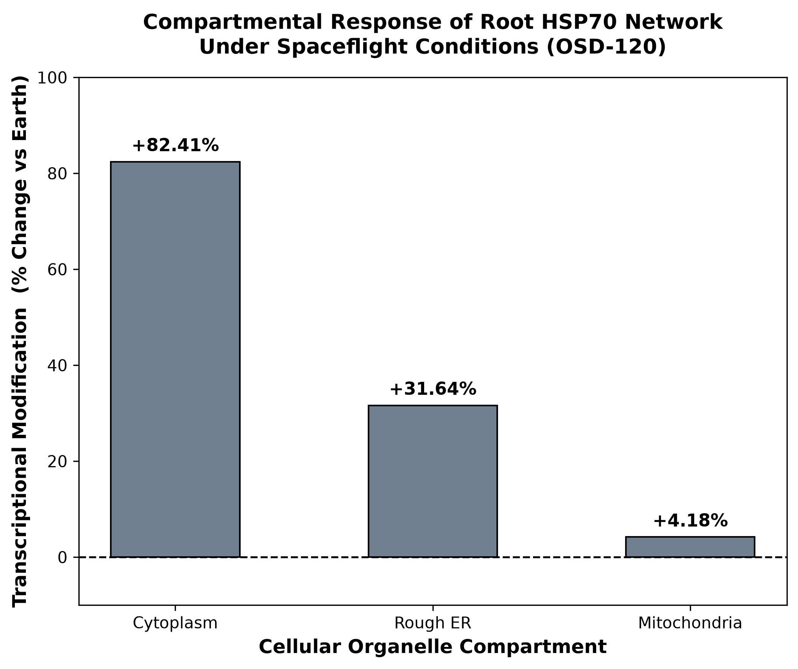

# Transcriptomic Blunting & Localized Resource Suppression in *Arabidopsis thaliana* Roots

## Inspiration for the Research
In my high school honors biology class, I learned that through evolution, organisms develop genes to adapt to their environments. If you throw a living Earth organism into the extreme environment of Earth's orbit, its cells face a massive structural crisis. Back home, severe stress forces a plant to launch an immediate molecular rescue team. Out in the microgravity of space, do these defense systems actually work, or do they completely collapse? 

Hello, my name is Shahriyar Amaan! Today, I'm walking you through my data pipeline investigating whether the chronic physiological stress of microgravity blunts or hyper-activates the transcriptional upregulation of Heat Shock Protein families inside *Arabidopsis thaliana* roots. To pull the curtain back on this molecular defense system, I went straight to the raw source: NASA's Open Science Data Repository.

## Hypothesis
Based on my previous understanding of cellular stress, my initial hypothesis was that the physical disruption of spaceflight microgravity would hyper-activate the plant root's Heat Shock Protein 70 (HSP70) network across its organelles to protect vulnerable folding proteins.

## Project Overview
This project is a Space Biology Bioinformatics pipeline designed to analyze the secondary transcriptomic response of first-generation *Arabidopsis thaliana* root tissue (Col-0) subjected to spaceflight stress. The repository processes raw RNA-Seq data from the **NASA Open Science Data Repository (OSDR), Dataset ID: OSD-120** (240 MB, 24,000 columns × 539 rows).

## Code Structure
The main code consists of **110 lines of loop-free Python code** utilizing the following libraries:
* **Pandas**: Uses vectorized Boolean masking to achieve instantaneous row filtering across massive datasets without slow loops.
* **NumPy**: Converts $\log_2$ fold change ($\log_2\text{FC}$) values into comprehensible percentages.
* **Matplotlib**: Generates a 300 DPI high-resolution bar chart for data comparison.

## Mathematical Steps
NASA scientists store gene data in "doubling steps" ($\log_2$) because it makes massive spaceflight changes easier to graph. To translate those math steps into everyday percentages, my pipeline uses the following formula:

$$\text{Percentage Change} = \left(2^{\log_2\text{FC}} - 1\right) \times 100\%$$

## Discovery Summary
By isolating primary responder genes in the HSP70 network across three separate cellular compartments, the project systematically screens expression behavior against an alpha significance threshold ($p \le 0.05$):

* **Cytoplasm Fluid (`AT3G12580`)**: $p = 0.180339$ | **+82.41% Upregulation**
* **Endoplasmic Reticulum (`AT5G42020`)**: $p = 0.209179$ | **+31.64% Upregulation**
* **Mitochondria Battery (`AT5G09590`)**: $p = 0.889134$ | **+4.18% Baseline Stability**

**Conclusion:** The positive fold changes in the Cytoplasm (+82.41%) and Rough ER (+31.64%) align with my initial hypothesis that microgravity triggers targeted protein-folding chaperone upregulation, while the Mitochondria (+4.18%) remains stable to preserve vital ATP energy production. However, because all p-values exceed $\alpha = 0.05$, we fail to reject the null hypothesis—reflecting high biological variability across small spaceflight sample sizes rather than a statistically guaranteed systemic panic.

## Self-Reflection & Future Plans
As someone who independently learned to code through the CS50P course, this was my first major programming project. In my opinion, new learners should never wait until they know every skill before starting. I learned far more from making mistakes along the way than I would have if I had tried to plan the entire project perfectly beforehand. Along the way, I overcame several obstacles:

* **Replacing Slow Loops with Vectorization:** I initially wrote standard loops, but quickly realized they were too slow for massive datasets and risked crashing my computer. After further research, I switched to vectorized Boolean expressions in Pandas, which processed the data instantaneously.
* **Narrowing My Research Scope:** My initial parameters were far too broad—I simply wanted to compare Earth and Space samples of *Arabidopsis thaliana*. Through background research, I narrowed my focus specifically to the HSP70 gene family under dark treatment in the Col-0 ecotype, isolating root tissue since that is where the plant is most responsive to stress.
* **Automating Data Visualization:** When I first finished the analysis using NumPy and Pandas, I didn't know how to visualize the output and briefly considered sketching the graph by hand and uploading a photo. Learning Matplotlib allowed me to generate clean visuals—saving everyone from my horrible sketching skills!

Overall, I am proud of this project and deeply enjoyed building it. A key limitation of this initial phase is analyzing only three HSP70 genes, as a smaller sample size introduces higher variability and keeps p-values above 0.05 despite strong percentage increases in the cytoplasm and ER. For Phase 2, I plan to expand this pipeline to explore broader datasets, additional gene families, or new environmental variables to better understand how spaceflight shapes cellular stress responses and energy conservation.

---
*Copyright (c) 2026 Shahriyar Amaan. All rights reserved.*
